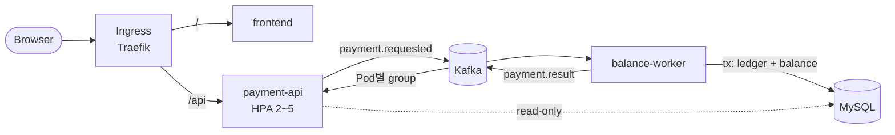

# K8s Lab: 비동기 결제 플랫폼

Kubernetes 학습용 토이 프로젝트입니다. 실무에서 흔히 쓰는 K8s 컴포넌트를 한 번씩 모두 사용하도록 구성했습니다.

```
브라우저 → Traefik Ingress → frontend (nginx)
                           → payment-api (Spring Boot, 인메모리 저장 + Kafka 비동기 발행)
                                 → Kafka (payment.requested)
                                       → balance-worker (Spring Boot, 멱등 처리)
                                             → MySQL (잔고/원장)
                                             → Kafka (payment.result) → payment-api 인메모리 갱신
```



## 기술 스택
| 영역 | 사용 기술 |
|---|---|
| 로컬 환경 | Windows 11 + WSL2 Ubuntu + Docker Desktop + **kind** (3노드) |
| 앱 | Java 21, Spring Boot 4.1, Spring Kafka, nginx |
| 데이터 | Apache Kafka 4.3 (KRaft), MySQL 8.4 |
| 배포 | Kustomize (데이터 계층), Helm (앱/플랫폼), **Argo CD** (GitOps) |
| 플랫폼 | Traefik, metrics-server, kube-prometheus-stack (Prometheus/Grafana) |

## 빠른 시작 (WSL Ubuntu에서)

스크립트 없이 각 문서의 명령을 **한 줄씩 직접 실행**하며 진행합니다.

| 단계 | 내용 | 문서 |
|---|---|---|
| 0 | WSL2, `.wslconfig` 메모리, Docker Desktop WSL Integration | [01 §3.1~3.4](docs/01-environments.md#3-windows-로컬-환경-준비-1회) |
| 1 | kubectl, kind, helm, k9s 설치 | [01 §3.5](docs/01-environments.md#35-cli-도구-설치-kubectl-kind-helm-k9s) |
| 2 | kind 클러스터 생성 (control-plane 1 + worker 2) | [01 §3.6](docs/01-environments.md#36-kind-클러스터-생성-control-plane-1--worker-2) |
| 3 | Traefik, metrics-server, Prometheus/Grafana, Argo CD (Helm) | [01 §4](docs/01-environments.md#4-플랫폼-설치-helm) |
| 4 | 앱 이미지 빌드 → kind 노드에 적재 | [06 Lab 2-1](docs/06-labs.md#2-1-이미지-빌드--kind-노드에-적재) |
| 5 | 데이터 계층(Kustomize) + 앱(Helm) 배포 | [06 Lab 2-2~2-6](docs/06-labs.md#lab-2-배포하고-e2e-확인) |

| URL | 설명 |
|---|---|
| http://payment.localtest.me | 결제 데모 화면 |
| http://grafana.localtest.me | Grafana (admin / admin) → "K8s Lab - Payment Platform" |
| http://argocd.localtest.me | Argo CD (admin / [01 §4.5](docs/01-environments.md#45-argo-cd--선택)에서 확인한 비밀번호) |

GitOps로 전환: GitHub에 push → [05 §4 시작하기](docs/05-tooling.md#시작하기)

정리: `kind delete cluster --name k8s-lab`

> K8s 없이 앱만 먼저 확인하려면: `cd apps && docker compose up --build` → http://localhost:8088

## 디렉터리 구조
```
apps/
  frontend/            정적 페이지 (nginx-unprivileged)
  payment-api/         Spring Boot: POST /api/payments → 202, 인메모리 상태, Kafka 발행
  balance-worker/      Spring Boot: Kafka 소비 → MySQL 트랜잭션 → 결과 발행, DLT
  docker-compose.yml   로컬 smoke test
deploy/
  kind/                kind 클러스터 설정 (노드 라벨, 포트 매핑)
  platform/            서드파티 Helm values (traefik, metrics-server, prometheus, argocd)
  kustomize/data/      Kafka, MySQL, Job, CronJob, NetworkPolicy, RBAC, Quota (base + dev/prod)
  helm/payment-apps/   앱 3개 Helm 차트 (values-dev / values-prod)
  monitoring/          Grafana 대시보드 ConfigMap
  argocd/              App of Apps (Helm 차트) + root-app.yaml
docs/                  학습 문서 (mermaid 다이어그램 포함)
```

## 문서
| | |
|---|---|
| [00 개요/로드맵](docs/00-overview.md) | 학습 순서, 컴포넌트 커버리지 표 |
| [01 실행 환경](docs/01-environments.md) | **Ubuntu 서버에서는 어떻게 쓰나**, Windows 권장 환경 |
| [02 아키텍처](docs/02-architecture.md) | 시스템, 노드 토폴로지, 네임스페이스, ERD |
| [03 컴포넌트](docs/03-components.md) | 컴포넌트별 설명, 위치, 확인 명령 |
| [04 워크플로우](docs/04-workflows.md) | **상세 mermaid**: 결제, 라우팅, Kafka, 장애, 라이프사이클, HPA, GitOps |
| [05 도구](docs/05-tooling.md) | Helm, Kustomize, Argo CD |
| [06 실습](docs/06-labs.md) | 15개 실습 시나리오 |
| [07 서버 이전](docs/07-to-ubuntu-server.md) | k3s/kubeadm으로 옮기기 |
| [08 FAQ](docs/08-faq.md) | **처음 접할 때 헷갈리는 것들**: kind·helm·Argo CD 동작 위치, 스케줄링, 확장, Kafka offset, reconcile, Lab 2 배포 명령 |
