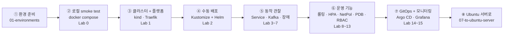

# 00. 개요와 학습 로드맵

## 목표
- 실무에서 흔히 쓰는 K8s 리소스를 **한 번씩 모두** 직접 써 본다
- Stateless(앱)와 Stateful(Kafka, MySQL) 워크로드의 차이를 체감한다
- 이벤트 기반 비동기 처리에서 생기는 문제(순서, 중복, 실패, 인메모리 상태)를 K8s 위에서 관찰한다
- 로컬(Windows + WSL2 + kind)에서 익힌 것을 그대로 Ubuntu 서버로 가져갈 수 있게 한다
- 배포 방식을 **kubectl → Kustomize/Helm → GitOps(Argo CD)** 순서로 발전시킨다

## 학습 순서

## 문서 목록

| 문서 | 내용 |
|---|---|
| [01-environments.md](01-environments.md) | Ubuntu 서버의 K8s 설치 방식, Windows 권장 환경, 로컬 준비 |
| [02-architecture.md](02-architecture.md) | 시스템 구성, 클러스터 토폴로지, 네임스페이스, 데이터 모델 |
| [03-components.md](03-components.md) | K8s 컴포넌트별 설명, 프로젝트 내 위치, 확인 명령 |
| [04-workflows.md](04-workflows.md) | 결제 흐름, 라우팅, Kafka, 장애, 라이프사이클, HPA, GitOps 다이어그램 |
| [05-tooling.md](05-tooling.md) | Helm, Kustomize, Argo CD 역할 분담과 사용법 |
| [06-labs.md](06-labs.md) | 실습 시나리오 15개 |
| [07-to-ubuntu-server.md](07-to-ubuntu-server.md) | k3s/kubeadm 서버로 옮길 때 바뀌는 점 |
| [08-faq.md](08-faq.md) | 처음 접할 때 헷갈리는 것들 (환경, 설치 위치, 스케줄링, 확장, 데이터/메시징, 배포 명령) |

## 컴포넌트 커버리지

| 분류 | 컴포넌트 | 프로젝트 내 위치 |
|---|---|---|
| 워크로드 | Deployment / ReplicaSet | `deploy/helm/payment-apps/templates/*.yaml` |
| | StatefulSet + volumeClaimTemplates | `deploy/kustomize/data/base/{kafka,mysql}/statefulset.yaml` |
| | DaemonSet | node-exporter(kube-prometheus-stack), kindnet, kube-proxy |
| | Job | `deploy/kustomize/data/base/jobs/kafka-topic-init.yaml` |
| | CronJob | `deploy/kustomize/data/base/jobs/balance-reconcile.yaml` |
| Pod 설계 | initContainer, startup/liveness/readiness probe, preStop | `templates/_helpers.tpl`, `payment-api.yaml` |
| | Downward API, securityContext, emptyDir | `payment-api.yaml`, `kafka/statefulset.yaml` |
| 네트워킹 | Service(ClusterIP), Headless Service | 앱 템플릿, `kafka/service.yaml`, `mysql/service.yaml` |
| | NodePort | `deploy/platform/traefik-values.yaml` |
| | Ingress (Traefik) | `templates/ingress.yaml` |
| | NetworkPolicy | `deploy/kustomize/data/base/policies/network-policy.yaml` |
| 설정/보안 | ConfigMap (generator, subPath, checksum) | `base/kustomization.yaml`, `templates/frontend.yaml` |
| | Secret | `overlays/*/kustomization.yaml`, `templates/secret.yaml` |
| | ServiceAccount, Role, RoleBinding | `templates/serviceaccounts.yaml`, `policies/rbac.yaml` |
| 스토리지 | PVC / PV / StorageClass | StatefulSet `volumeClaimTemplates` (kind `standard`) |
| 스케줄링 | nodeAffinity, taint/toleration, topologySpread, requests/limits | StatefulSet, `traefik-values.yaml`, 앱 템플릿 |
| 운영 | HPA + metrics-server | `templates/payment-api.yaml`, `deploy/platform/metrics-server-values.yaml` |
| | PodDisruptionBudget | `templates/payment-api.yaml`, `balance-worker.yaml` |
| | ResourceQuota, LimitRange | `policies/resource-quota.yaml`, `limit-range.yaml` |
| | Namespace (환경 분리) | `overlays/*/namespace.yaml`, Argo CD `CreateNamespace` |
| 확장 | CRD (ServiceMonitor, Application) | `templates/servicemonitor.yaml`, `deploy/argocd/` |
| 도구 | Helm, Kustomize, Argo CD, Prometheus, Grafana | `deploy/` 전체 |

## 일부러 남긴 "학습용 한계"
| 한계 | 왜 남겼나 | 실무 해법 |
|---|---|---|
| payment-api 인메모리 상태 | Stateless 원칙을 체감하기 위해 | Redis, DB |
| Kafka/MySQL 단일 replica + local PV | 리소스 절약, 장애 시 영향 관찰 | Operator(Strimzi 등), 복제, 네트워크 스토리지 |
| dev Secret 평문 커밋 | 흐름 단순화 | Sealed Secrets, External Secrets |
| 레지스트리 없이 `kind load` | 로컬 단순화 | GHCR/Harbor + CI |
| HTTP(평문) | 로컬 단순화 | cert-manager + TLS |
