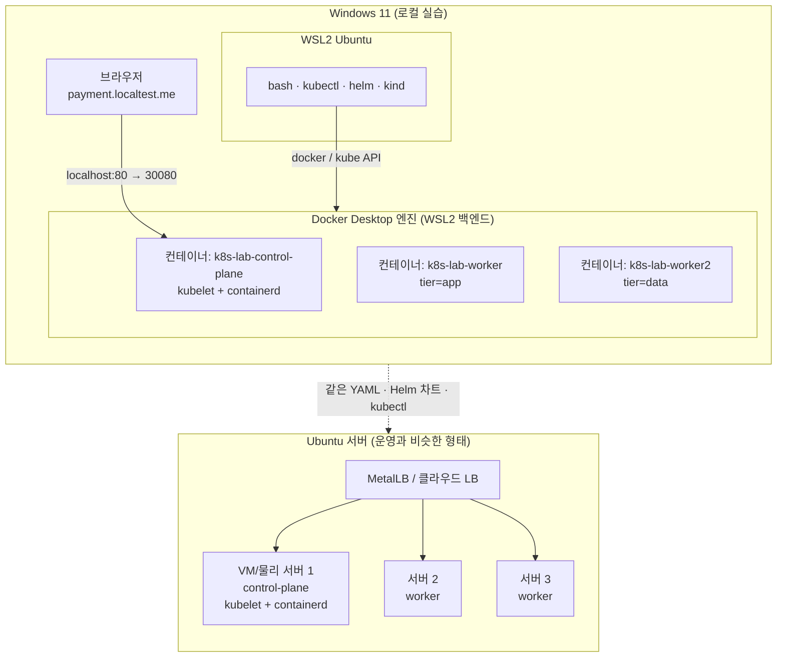
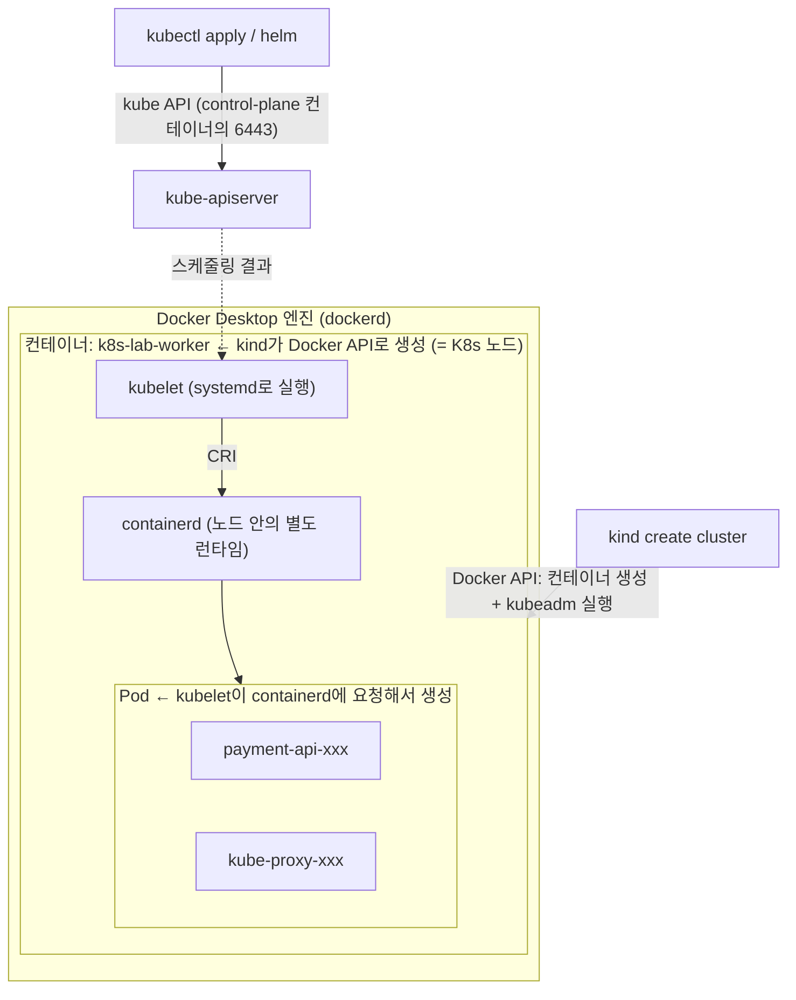

# 01. 실행 환경: Ubuntu 서버 vs Windows 로컬

이 프로젝트의 매니페스트(YAML), Helm 차트, `kubectl` 명령은 **어떤 클러스터에서든 똑같이 동작**합니다.
환경마다 달라지는 것은 "클러스터를 어떻게 설치하는가"와 인프라 성격의 몇 가지(Ingress 노출, LoadBalancer, StorageClass, 이미지 레지스트리)뿐입니다.

---

## 1. 일반적인 Linux(Ubuntu) 서버에서 K8s를 쓰는 방식

| 방식 | 설치 | 특징 | 주로 쓰는 곳 |
|---|---|---|---|
| **kubeadm** | containerd + kubelet + kubeadm 설치 → `kubeadm init` → CNI 설치 → worker에서 `kubeadm join` | 업스트림 표준 방식. 구성 요소를 하나하나 직접 고른다 (CNI, Ingress, LB, 스토리지) | 온프레미스 운영, CKA 시험 |
| **k3s** | `curl -sfL https://get.k3s.io \| sh -` | 단일 바이너리 경량 배포판. Traefik(Ingress), ServiceLB, local-path 스토리지, metrics-server 기본 포함 | 소규모 서버, 엣지, 홈랩 |
| **MicroK8s** | `sudo snap install microk8s --classic` | Canonical(Ubuntu) 제작. `microk8s enable ingress dns ...` 로 addon을 켬 | Ubuntu 친화 환경 |
| **관리형** (EKS/GKE/AKS) | 클라우드 콘솔/Terraform | control-plane을 클라우드가 운영. LB, 스토리지가 클라우드와 연동 | 실무 운영 대다수 |

### kubeadm 흐름 (요약)
```bash
# 모든 노드 공통
sudo swapoff -a                                    # kubelet은 기본적으로 swap을 허용하지 않음
sudo modprobe overlay && sudo modprobe br_netfilter
sudo apt-get install -y containerd                 # 컨테이너 런타임 (CRI)
# pkgs.k8s.io 저장소 등록 후
sudo apt-get install -y kubelet kubeadm kubectl

# control-plane 노드
sudo kubeadm init --pod-network-cidr=10.244.0.0/16
mkdir -p ~/.kube && sudo cp /etc/kubernetes/admin.conf ~/.kube/config && sudo chown $(id -u):$(id -g) ~/.kube/config
kubectl apply -f <CNI 매니페스트: Calico / Flannel / Cilium>

# worker 노드 (init 결과로 출력된 명령)
sudo kubeadm join <cp-ip>:6443 --token ... --discovery-token-ca-cert-hash sha256:...
```

### k3s 흐름 (요약)
```bash
# 서버(control-plane)
curl -sfL https://get.k3s.io | sh -
sudo cat /var/lib/rancher/k3s/server/node-token     # join 토큰
# 에이전트(worker)
curl -sfL https://get.k3s.io | K3S_URL=https://<server>:6443 K3S_TOKEN=<token> sh -
# kubeconfig
sudo cat /etc/rancher/k3s/k3s.yaml
```

---

## 2. Windows에서 비슷하게 쓰는 방법

| 환경 | Ubuntu 서버와의 유사도 | 장점 | 단점 |
|---|---|---|---|
| **WSL2 Ubuntu + Docker Desktop + kind** ✅ | ★★★★ | bash와 Linux 도구 그대로 사용, 멀티노드, 생성/삭제가 빠름 | 노드가 컨테이너라 커널 수준 설정 실습은 제한 |
| WSL2 Ubuntu + k3s | ★★★★ | 실제 서버와 같은 k3s | 단일 노드, WSL systemd 필요 |
| Hyper-V/Multipass VM + kubeadm | ★★★★★ | 실제 서버 구축과 거의 같음 | 무겁고 손이 많이 감 |
| Docker Desktop 내장 Kubernetes | ★★ | 체크박스 하나로 켜짐 | PowerShell 중심, 단일 노드, 설정 자유도 낮음 |

### 이 프로젝트의 선택: **WSL2 Ubuntu + kind (control-plane 1 + worker 2)**

1. **같은 셸**: 모든 명령은 bash로 WSL Ubuntu에서 실행합니다 → 나중에 Ubuntu 서버에서 그대로 실행됩니다.
2. **멀티노드**: nodeAffinity로 노드 고정, topologySpread로 분산, DaemonSet이 노드마다 하나씩 뜨는 동작, 노드 drain과 PDB를 직접 볼 수 있습니다.
3. **실제와 같은 구조**: kind도 내부적으로 **kubeadm**으로 클러스터를 부트스트랩합니다. 노드 컨테이너 안에서 kubelet과 containerd가 실제로 동작합니다.
4. **망가뜨려도 괜찮음**: `kind delete cluster` 한 번이면 처음 상태로 돌아갑니다.



---

## 3. Windows 로컬 환경 준비 (1회)

### 3.1 WSL2 + Ubuntu
PowerShell(관리자):
```powershell
wsl --install -d Ubuntu-24.04
wsl --set-default-version 2
```

### 3.2 WSL 메모리 할당 (`%UserProfile%\.wslconfig`)
Kafka, MySQL, Prometheus, ArgoCD를 모두 띄우면 **약 6~8GB**를 씁니다.
```ini
[wsl2]
memory=10GB
processors=4
swap=4GB
```
적용: `wsl --shutdown` 후 다시 시작합니다.

### 3.3 Docker Desktop
- Settings → General → **Use the WSL 2 based engine** 켜기
- Settings → Resources → **WSL Integration** → `Ubuntu-24.04` 켜기
- Settings → Kubernetes는 **끈 상태로 둡니다** (kind를 쓰므로)

### 3.4 소스 위치
`/mnt/c/...`(Windows 디스크)는 WSL에서 파일 I/O가 느려서 Docker 빌드가 오래 걸립니다. **WSL 홈으로 clone하는 것을 권장**합니다.
```bash
cd ~ && git clone <your-repo-url> k8s-lab && cd k8s-lab
# 또는 지금 폴더를 그대로 쓸 경우
cd /mnt/c/dev/k8s
```
> VS Code에서는 `code .`(WSL 확장)로 열면 WSL 안의 파일을 그대로 편집할 수 있습니다.

### 3.5 CLI 도구 설치 (kubectl, kind, helm, k9s)
WSL Ubuntu에서 한 줄씩 실행합니다. Ubuntu 서버에서도 똑같이 동작합니다.

```bash
# 0) 기본 패키지
sudo apt-get update
sudo apt-get install -y curl ca-certificates tar git jq

# 1) Docker 연결 확인 → 에러가 나면 Docker Desktop > Settings > Resources > WSL Integration 확인
docker info

# CPU 아키텍처 (amd64 | arm64). 아래 다운로드 URL에 쓴다
ARCH=$(dpkg --print-architecture); echo $ARCH
```

```bash
# 2) kubectl: 최신 stable 버전
KUBECTL_VERSION=$(curl -fsSL https://dl.k8s.io/release/stable.txt); echo $KUBECTL_VERSION
curl -fsSLo /tmp/kubectl "https://dl.k8s.io/release/${KUBECTL_VERSION}/bin/linux/${ARCH}/kubectl"
sudo install -m 0755 /tmp/kubectl /usr/local/bin/kubectl
kubectl version --client
```

```bash
# 3) kind: 노드를 Docker 컨테이너로 띄우는 클러스터 도구
curl -fsSLo /tmp/kind "https://kind.sigs.k8s.io/dl/v0.33.0/kind-linux-${ARCH}"
sudo install -m 0755 /tmp/kind /usr/local/bin/kind
kind version
```

```bash
# 4) helm
curl -fsSL "https://get.helm.sh/helm-v4.3.0-linux-${ARCH}.tar.gz" | tar -xz -C /tmp
sudo install -m 0755 /tmp/linux-${ARCH}/helm /usr/local/bin/helm
helm version --short
```

```bash
# 5) k9s (선택): 터미널 UI
curl -fsSL "https://github.com/derailed/k9s/releases/latest/download/k9s_Linux_${ARCH}.tar.gz" | tar -xz -C /tmp k9s
sudo install -m 0755 /tmp/k9s /usr/local/bin/k9s
```

```bash
# 6) 자동완성 + k 별칭 (~/.bashrc에 한 번만 추가)
cat >> ~/.bashrc <<'EOF'
# k8s-lab aliases
source <(kubectl completion bash)
alias k=kubectl
complete -o default -F __start_kubectl k
EOF
source ~/.bashrc
```
> `install -m 0755`는 `cp` + `chmod +x`를 한 번에 하는 명령입니다. 이미 설치된 도구는 해당 단계를 건너뛰어도 됩니다 (`command -v kind`로 확인).

### 3.6 kind 클러스터 생성 (control-plane 1 + worker 2)
이후의 모든 명령은 **저장소 루트**(`deploy/`, `apps/`, `docs/`가 보이는 폴더. 3.4에서 clone한 `~/k8s-lab` 또는 `/mnt/c/dev/k8s`)에서 실행합니다. `git rev-parse --show-toplevel`로 확인할 수 있습니다.
> 폴더 이름 `k8s-lab`과 **클러스터 이름** `k8s-lab`(`kind-config.yaml`의 `name:`)은 별개입니다. 아래 `kind-k8s-lab`, `name=k8s-lab`은 클러스터 이름입니다.

```bash
# 설정 파일 먼저 읽어 보기: 노드 3개, tier 라벨, 80/443 포트 매핑
cat deploy/kind/kind-config.yaml

kind get clusters                       # 이미 k8s-lab이 있으면 생성 단계는 건너뜀
kind create cluster --config deploy/kind/kind-config.yaml --wait 120s

kubectl config use-context kind-k8s-lab # kind는 컨텍스트 이름에 kind- 접두사를 붙인다
kubectl get nodes -L tier -o wide       # 3개 노드, worker에 tier=app / tier=data
docker ps --filter name=k8s-lab         # 노드 = Docker 컨테이너
kubectl get daemonsets -n kube-system   # 노드마다 1개씩 뜨는 Pod (kindnet, kube-proxy)
```

#### kind가 Docker API로 만드는 것: Pod가 아니라 "노드"
kind는 Docker API를 쓰는 **노드 생성기**입니다. Docker로 만드는 건 **노드 컨테이너**까지이고, **Pod는 그 안에서 kubelet과 containerd가 만듭니다.** Docker는 Pod의 존재를 모릅니다.



| 대상 | 만드는 주체 | 사용하는 API | 확인 명령 |
|---|---|---|---|
| 노드(컨테이너) 3개, `kind` 네트워크 | **kind** | Docker API | `docker ps --filter name=k8s-lab` |
| 클러스터 부트스트랩(API 서버, etcd 등) | kind가 노드 안에서 실행한 **kubeadm** | (노드 내부 명령) | `kubectl get pods -n kube-system` |
| Pod / 컨테이너 | 노드 안의 **kubelet → containerd** | CRI | `docker exec k8s-lab-worker crictl ps` |
| Deployment, Service 등 리소스 | **kubectl / helm** | kube API | `kubectl get all -A` |

직접 확인해 보세요.
```bash
docker ps --format '{{.Names}}' | grep k8s-lab     # 3개뿐. Pod는 Docker 목록에 나타나지 않는다
docker exec k8s-lab-worker crictl ps               # 노드 "안"의 containerd가 실행 중인 Pod 컨테이너들
docker ps -a --filter label=io.x-k8s.kind.cluster \
  --format '{{.Names}}  {{.Label "io.x-k8s.kind.cluster"}}'   # kind get clusters의 실체 = 이 라벨 조회
```

알아 둘 점:
- **kind에는 데몬도, 상태 저장소도 없습니다.** `kind get clusters`는 노드 컨테이너에 붙은 `io.x-k8s.kind.cluster` 라벨을 Docker에 그때그때 조회한 결과입니다.
- **클러스터가 만들어진 뒤에는 kind가 개입하지 않습니다.** 이후 작업은 모두 kubectl과 helm이 kube API로 합니다. kind가 다시 등장하는 건 `kind load docker-image`와 `kind delete cluster`뿐입니다.
- **`kind load`가 필요한 이유도 이 구조 때문입니다.** `docker build`로 만든 이미지는 호스트 dockerd의 저장소에 있고, Pod를 띄우는 건 노드 안의 containerd입니다. 둘은 이미지 저장소가 다르기 때문에 노드 안으로 복사해 줘야 합니다(06 Lab 2-1).
- **Ubuntu 서버로 옮기면** "노드 컨테이너" 자리가 VM이나 물리 서버로 바뀔 뿐, 노드 안의 kubelet → containerd → Pod 구조는 같습니다(07 문서).

### 3.7 도메인
`*.localtest.me`는 공용 DNS에서 항상 `127.0.0.1`로 응답하는 도메인이라 **hosts 파일을 고칠 필요가 없습니다.**
Windows 브라우저 → `localhost:80` → Docker Desktop 포트 포워딩 → kind control-plane 컨테이너 `30080`(Traefik NodePort) 순서로 전달됩니다.
> 사내 DNS가 외부 도메인을 막는다면 `C:\Windows\System32\drivers\etc\hosts`에 `127.0.0.1 payment.localtest.me grafana.localtest.me argocd.localtest.me`를 추가하세요.

---

## 4. 플랫폼 설치 (Helm)

클러스터 공용 컴포넌트를 공식 Helm 차트로 설치합니다. 우리가 바꾸는 것은 `deploy/platform/*-values.yaml` 값뿐입니다.
설치 전에 values 파일을 한 번씩 열어 보고, 설치 후에는 `kubectl get pods -n <ns>`로 무엇이 생겼는지 확인하세요.

### 4.1 Helm 저장소 등록
```bash
helm repo add traefik https://traefik.github.io/charts
helm repo add metrics-server https://kubernetes-sigs.github.io/metrics-server/
helm repo add prometheus-community https://prometheus-community.github.io/helm-charts
helm repo add argo https://argoproj.github.io/argo-helm
helm repo update
helm search repo traefik/traefik        # 설치될 차트 버전 확인
```

### 4.2 Traefik (Ingress Controller)
```bash
helm upgrade --install traefik traefik/traefik \
  -n traefik --create-namespace \
  -f deploy/platform/traefik-values.yaml --wait

kubectl get pods,svc -n traefik         # Service가 NodePort 30080/30443인지 확인
```
> `upgrade --install`은 "없으면 설치, 있으면 업그레이드"라서 몇 번을 다시 실행해도 안전합니다.

### 4.3 metrics-server (`kubectl top`, HPA)
```bash
helm upgrade --install metrics-server metrics-server/metrics-server \
  -n kube-system -f deploy/platform/metrics-server-values.yaml --wait

kubectl top nodes                       # 1분쯤 지나면 값이 나온다
```

### 4.4 kube-prometheus-stack (Prometheus Operator, Prometheus, Grafana, node-exporter) — 선택
```bash
helm upgrade --install monitoring prometheus-community/kube-prometheus-stack \
  -n monitoring --create-namespace \
  -f deploy/platform/kube-prometheus-stack-values.yaml --wait --timeout 10m

kubectl get pods -n monitoring
kubectl get crd | grep monitoring.coreos.com   # ServiceMonitor 등 CRD가 추가됨
```
Grafana: http://grafana.localtest.me (admin / admin)

### 4.5 Argo CD — 선택
```bash
helm upgrade --install argocd argo/argo-cd \
  -n argocd --create-namespace \
  -f deploy/platform/argocd-values.yaml --wait --timeout 10m

kubectl get pods -n argocd
# 초기 admin 비밀번호
kubectl -n argocd get secret argocd-initial-admin-secret -o jsonpath='{.data.password}' | base64 -d; echo
```
Argo CD: http://argocd.localtest.me (admin / 위 비밀번호)

### 4.6 확인
```bash
helm list -A
```

### 4.7 리소스 절약 모드
선택 단계(4.4, 4.5)를 건너뛰면 메모리를 아낄 수 있습니다.

| 구성 | 메모리(대략) | 방법 |
|---|---|---|
| 전체 | 7~8GB | 4.2 ~ 4.5 모두 실행 |
| ArgoCD 제외 | 6GB | 4.5 생략 |
| 모니터링 제외 | 5GB | 4.4 생략 |
| 앱 + 데이터만 | 3.5GB | 4.4, 4.5 모두 생략 |

> k3s처럼 Traefik과 metrics-server가 내장된 클러스터에서는 4.2, 4.3을 생략합니다.

---

## 5. 정리
```bash
kind delete cluster --name k8s-lab      # 노드 컨테이너와 그 안의 PV 데이터가 모두 사라진다
```
다시 시작하려면 [3.6](#36-kind-클러스터-생성-control-plane-1--worker-2)부터 진행합니다.

Ubuntu 서버로 옮길 때 무엇이 바뀌는지는 [07-to-ubuntu-server.md](07-to-ubuntu-server.md)를 참고하세요.
