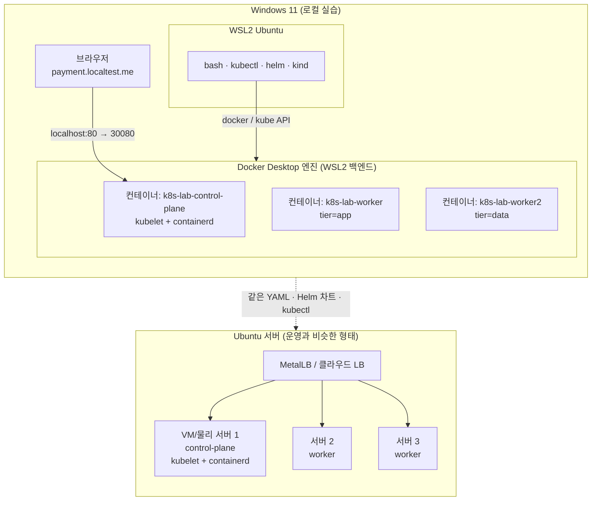

# 01. 실행 환경: Ubuntu 서버 vs Windows 로컬

이 프로젝트의 매니페스트(YAML), Helm 차트, `kubectl` 명령은 **어떤 클러스터에서든 똑같이 동작**합니다.
환경마다 달라지는 것은 "클러스터를 어떻게 설치하는가"와 인프라 성격의 몇 가지(Ingress 노출, LoadBalancer, StorageClass, 이미지 레지스트리)뿐입니다.

---

## 1. 일반적인 Linux(Ubuntu) 서버에서 K8s를 쓰는 방식

| 방식 | 설치 | 특징 | 주로 쓰는 곳 |
|---|---|---|---|
| **kubeadm** | containerd + kubelet + kubeadm 설치 → `kubeadm init` → CNI 설치 → worker에서 `kubeadm join` | 업스트림 표준 방식. 구성 요소를 하나하나 직접 고른다 (CNI, Ingress, LB, 스토리지) | 온프레미스 운영, CKA 시험 |
| **k3s** | `curl -sfL https://get.k3s.io \| sh -` | 단일 바이너리 경량 배포판. Traefik(Ingress), ServiceLB, local-path 스토리지, metrics-server 기본 포함 | 소규모 서버, 엣지, 홈랩 |
| **MicroK8s** | `sudo snap install microk8s --classic` | Canonical(Ubuntu) 제작. `microk8s enable ingress dns ...` 로 addon을 켬 | Ubuntu 친화 환경 |
| **관리형** (EKS/GKE/AKS) | 클라우드 콘솔/Terraform | control-plane을 클라우드가 운영. LB, 스토리지가 클라우드와 연동 | 실무 운영 대다수 |

### kubeadm 흐름 (요약)
```bash
# 모든 노드 공통
sudo swapoff -a                                    # kubelet은 기본적으로 swap을 허용하지 않음
sudo modprobe overlay && sudo modprobe br_netfilter
sudo apt-get install -y containerd                 # 컨테이너 런타임 (CRI)
# pkgs.k8s.io 저장소 등록 후
sudo apt-get install -y kubelet kubeadm kubectl

# control-plane 노드
sudo kubeadm init --pod-network-cidr=10.244.0.0/16
mkdir -p ~/.kube && sudo cp /etc/kubernetes/admin.conf ~/.kube/config && sudo chown $(id -u):$(id -g) ~/.kube/config
kubectl apply -f <CNI 매니페스트: Calico / Flannel / Cilium>

# worker 노드 (init 결과로 출력된 명령)
sudo kubeadm join <cp-ip>:6443 --token ... --discovery-token-ca-cert-hash sha256:...
```

### k3s 흐름 (요약)
```bash
# 서버(control-plane)
curl -sfL https://get.k3s.io | sh -
sudo cat /var/lib/rancher/k3s/server/node-token     # join 토큰
# 에이전트(worker)
curl -sfL https://get.k3s.io | K3S_URL=https://<server>:6443 K3S_TOKEN=<token> sh -
# kubeconfig
sudo cat /etc/rancher/k3s/k3s.yaml
```

---

## 2. Windows에서 비슷하게 쓰는 방법

| 환경 | Ubuntu 서버와의 유사도 | 장점 | 단점 |
|---|---|---|---|
| **WSL2 Ubuntu + Docker Desktop + kind** ✅ | ★★★★ | bash와 Linux 도구 그대로 사용, 멀티노드, 생성/삭제가 빠름 | 노드가 컨테이너라 커널 수준 설정 실습은 제한 |
| WSL2 Ubuntu + k3s | ★★★★ | 실제 서버와 같은 k3s | 단일 노드, WSL systemd 필요 |
| Hyper-V/Multipass VM + kubeadm | ★★★★★ | 실제 서버 구축과 거의 같음 | 무겁고 손이 많이 감 |
| Docker Desktop 내장 Kubernetes | ★★ | 체크박스 하나로 켜짐 | PowerShell 중심, 단일 노드, 설정 자유도 낮음 |

### 이 프로젝트의 선택: **WSL2 Ubuntu + kind (control-plane 1 + worker 2)**

1. **같은 셸**: 모든 스크립트는 bash이고 WSL Ubuntu에서 실행합니다 → 나중에 Ubuntu 서버에서 그대로 실행됩니다.
2. **멀티노드**: nodeAffinity로 노드 고정, topologySpread로 분산, DaemonSet이 노드마다 하나씩 뜨는 동작, 노드 drain과 PDB를 직접 볼 수 있습니다.
3. **실제와 같은 구조**: kind도 내부적으로 **kubeadm**으로 클러스터를 부트스트랩합니다. 노드 컨테이너 안에서 kubelet과 containerd가 실제로 동작합니다.
4. **망가뜨려도 괜찮음**: `kind delete cluster` 한 번이면 처음 상태로 돌아갑니다.



---

## 3. Windows 로컬 환경 준비 (1회)

### 3.1 WSL2 + Ubuntu
PowerShell(관리자):
```powershell
wsl --install -d Ubuntu-24.04
wsl --set-default-version 2
```

### 3.2 WSL 메모리 할당 (`%UserProfile%\.wslconfig`)
Kafka, MySQL, Prometheus, ArgoCD를 모두 띄우면 **약 6~8GB**를 씁니다.
```ini
[wsl2]
memory=10GB
processors=4
swap=4GB
```
적용: `wsl --shutdown` 후 다시 시작합니다.

### 3.3 Docker Desktop
- Settings → General → **Use the WSL 2 based engine** 켜기
- Settings → Resources → **WSL Integration** → `Ubuntu-24.04` 켜기
- Settings → Kubernetes는 **끈 상태로 둡니다** (kind를 쓰므로)

### 3.4 소스 위치
`/mnt/c/...`(Windows 디스크)는 WSL에서 파일 I/O가 느려서 Docker 빌드가 오래 걸립니다. **WSL 홈으로 clone하는 것을 권장**합니다.
```bash
cd ~ && git clone <your-repo-url> k8s-lab && cd k8s-lab
# 또는 지금 폴더를 그대로 쓸 경우
cd /mnt/c/dev/k8s
```
> VS Code에서는 `code .`(WSL 확장)로 열면 WSL 안의 파일을 그대로 편집할 수 있습니다.

### 3.5 도구 설치와 클러스터 생성
```bash
./scripts/00-setup-wsl.sh   # kubectl, kind, helm, k9s
./scripts/10-cluster-up.sh  # kind 3노드 클러스터
```

### 3.6 도메인
`*.localtest.me`는 공용 DNS에서 항상 `127.0.0.1`로 응답하는 도메인이라 **hosts 파일을 고칠 필요가 없습니다.**
Windows 브라우저 → `localhost:80` → Docker Desktop 포트 포워딩 → kind control-plane 컨테이너 `30080`(Traefik NodePort) 순서로 전달됩니다.
> 사내 DNS가 외부 도메인을 막는다면 `C:\Windows\System32\drivers\etc\hosts`에 `127.0.0.1 payment.localtest.me grafana.localtest.me argocd.localtest.me`를 추가하세요.

---

## 4. 리소스 절약 모드
| 구성 | 메모리(대략) | 방법 |
|---|---|---|
| 전체 | 7~8GB | 기본 |
| ArgoCD 제외 | 6GB | `ARGOCD=false ./scripts/20-platform.sh` |
| 모니터링 제외 | 5GB | `MONITORING=false ./scripts/20-platform.sh` |
| 앱 + 데이터만 | 3.5GB | 둘 다 false |

Ubuntu 서버로 옮길 때 무엇이 바뀌는지는 [07-to-ubuntu-server.md](07-to-ubuntu-server.md)를 참고하세요.
