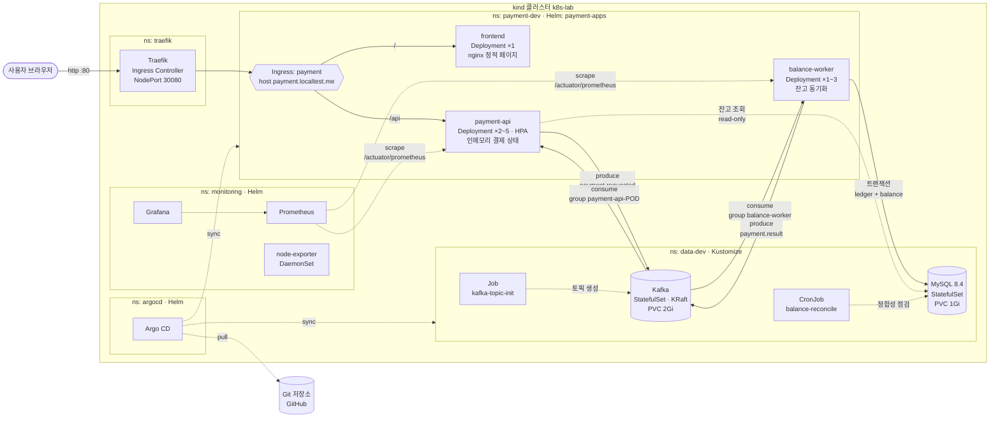
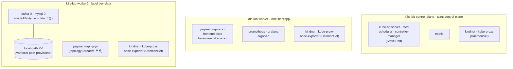
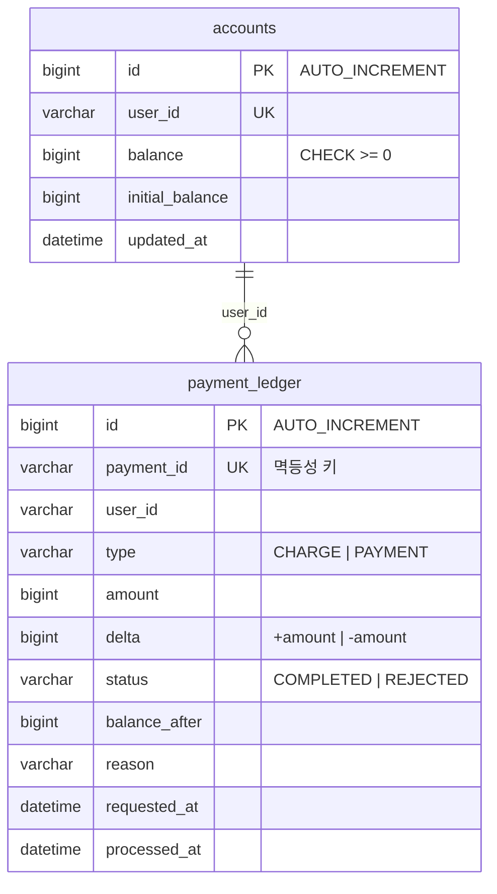

# 02. 아키텍처

## 1. 전체 시스템 구성

### 서비스별 책임

| 서비스 | 쓰기 | 읽기 | 상태 |
|---|---|---|---|
| frontend | – | – | Stateless |
| payment-api | Kafka `payment.requested` | 인메모리(결제 상태), MySQL `accounts`(read-only) | **인메모리 상태**가 있음 (학습용으로 일부러 둔 한계) |
| balance-worker | MySQL `payment_ledger`, `accounts` / Kafka `payment.result` | Kafka `payment.requested` | Stateless (상태는 DB에) |
| Kafka / MySQL | – | – | Stateful (PVC) |

---

## 2. 클러스터 토폴로지 (노드 × 네임스페이스 × Pod)

- **Static Pod**: control-plane 구성 요소는 kubelet이 `/etc/kubernetes/manifests`에서 직접 띄웁니다 (kubeadm 방식).
- **Taint/Toleration**: control-plane 노드에는 `NoSchedule` taint가 있어서 일반 Pod가 올라가지 않습니다. Traefik만 toleration으로 허용했습니다.
- **nodeAffinity (required)**: kafka와 mysql은 `tier=data` 노드에만 배치됩니다. PV(local-path)도 그 노드의 디스크에 생기므로 Pod가 다른 노드로 옮겨가면 데이터에 접근할 수 없습니다. 그래서 고정이 필요합니다.
- **topologySpreadConstraints**: payment-api replica가 두 worker에 고르게 퍼집니다.

---

## 3. 네임스페이스 설계

| 네임스페이스 | 관리 도구 | 내용 | 정책 |
|---|---|---|---|
| `traefik` | Helm (공식 차트) | Ingress Controller | – |
| `monitoring` | Helm (kube-prometheus-stack) + Kustomize(대시보드) | Prometheus, Grafana, node-exporter | – |
| `argocd` | Helm (argo-cd) | GitOps 컨트롤러 | – |
| `data-dev` / `data-prod` | **Kustomize** overlay | Kafka, MySQL, Job, CronJob | ResourceQuota, LimitRange, NetworkPolicy(default deny), RBAC |
| `payment-dev` / `payment-prod` | **Helm** (직접 만든 차트) | frontend, payment-api, balance-worker | 라벨 `k8slab.dev/role=app` (data 네임스페이스 접근 허용 조건) |

---

## 4. 데이터 모델

정합성 규칙(CronJob이 점검): `accounts.balance = initial_balance + SUM(delta WHERE status='COMPLETED')`

스키마는 balance-worker의 JPA 엔티티(`Account`, `PaymentLedger`)가 소유하며 `spring.jpa.hibernate.ddl-auto`(기본 `create`: 기동 시마다 DROP → 재생성)로 만들어지고, 초기 계좌는 `data.sql`로 들어갑니다. id는 `GenerationType.IDENTITY`(MySQL `AUTO_INCREMENT`)로 생성합니다.

## 5. Kafka 토픽

| 토픽 | 파티션 | Key | Producer | Consumer group |
|---|---|---|---|---|
| `payment.requested` | 3 | userId | payment-api | `balance-worker` (모든 worker Pod가 파티션을 나눠 가짐) |
| `payment.result` | 3 | userId | balance-worker | `payment-api-<pod-name>` (**Pod마다 다른 group** → 모든 Pod가 전체 이벤트를 받음) |
| `payment.requested.dlt` | 3 | – | balance-worker(실패 시) | 운영자가 수동 확인 |

자세한 흐름은 [04-workflows.md](04-workflows.md)를 참고하세요.
