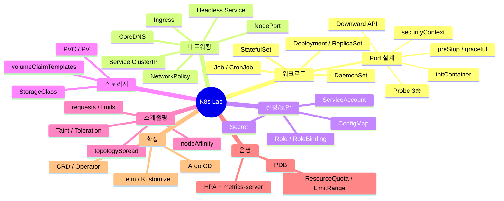
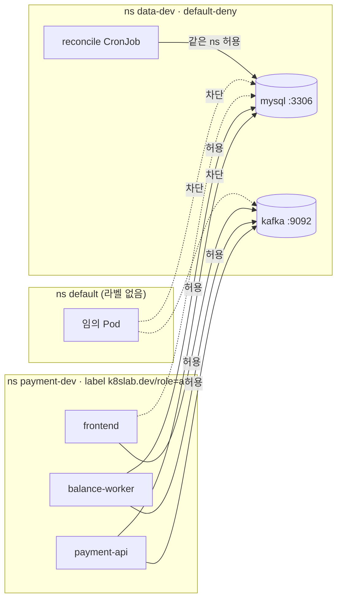

# 03. K8s 컴포넌트 레퍼런스

각 컴포넌트에 대해 **무엇인지 → 이 프로젝트 어디에 있는지 → 직접 확인하는 명령**을 정리했습니다.
네임스페이스는 dev 기준입니다(`data-dev`, `payment-dev`).



---

## 워크로드

### Pod
컨테이너 하나 이상과 네트워크/스토리지를 공유하는 최소 실행 단위입니다. 직접 만들지 않고 상위 컨트롤러(Deployment 등)가 만듭니다.
```bash
kubectl get pods -A -o wide                    # 어느 노드에 떠 있는지
kubectl describe pod -n payment-dev <pod>      # 이벤트, probe 실패, OOMKilled 확인
kubectl logs -n payment-dev <pod> -c wait-for-kafka   # initContainer 로그
```

### Deployment / ReplicaSet
**Stateless** 앱용입니다. Deployment가 버전별 ReplicaSet을 만들고, ReplicaSet이 Pod 수를 유지합니다.
- 위치: `deploy/helm/payment-apps/templates/{frontend,payment-api,balance-worker}.yaml`
- 포인트: `strategy.rollingUpdate.maxUnavailable: 0`, `revisionHistoryLimit: 5`
```bash
kubectl get deploy,rs -n payment-dev
kubectl scale deploy/balance-worker -n payment-dev --replicas=3
```

### StatefulSet
**Stateful** 앱용입니다. Pod 이름이 고정(`kafka-0`)되고, Pod마다 전용 PVC가 붙으며, 순서대로 생성/삭제됩니다.
- 위치: `deploy/kustomize/data/base/{kafka,mysql}/statefulset.yaml`
- 포인트: `serviceName`(Headless Service와 짝), `volumeClaimTemplates`
```bash
kubectl get sts,pvc -n data-dev
kubectl delete pod kafka-0 -n data-dev && kubectl get pod kafka-0 -n data-dev -w   # 같은 이름, 같은 PVC로 부활
```

### DaemonSet
**모든(또는 일부) 노드에 Pod를 하나씩** 띄웁니다. 로그 수집기, 모니터링 에이전트, CNI에 씁니다.
- 위치: 직접 만들지 않고, 이미 설치된 것을 관찰합니다 → `kube-system`의 `kindnet`, `kube-proxy`, `monitoring`의 `node-exporter`
```bash
kubectl get ds -A
kubectl get pods -n monitoring -l app.kubernetes.io/name=prometheus-node-exporter -o wide  # 노드 수만큼
```

### Job / CronJob
Job은 **끝나는 작업**(성공할 때까지 재시도), CronJob은 Job을 **주기적으로** 만듭니다.
- Job: `deploy/kustomize/data/base/jobs/kafka-topic-init.yaml` (ArgoCD PostSync 훅)
- CronJob: `deploy/kustomize/data/base/jobs/balance-reconcile.yaml` (`concurrencyPolicy: Forbid`, `timeZone`)
```bash
kubectl get jobs,cronjobs -n data-dev
kubectl create job -n data-dev --from=cronjob/balance-reconcile manual-1 && kubectl logs -n data-dev job/manual-1 -f
```

### Pod 설계 요소

| 요소 | 위치 | 설명 |
|---|---|---|
| **initContainer** | `_helpers.tpl` `payment-apps.waitFor` | 앱 컨테이너보다 먼저 순서대로 실행되고, 끝나야 다음으로 넘어감. Kafka/MySQL 포트가 열릴 때까지 대기 |
| **startupProbe** | `_helpers.tpl` `payment-apps.springProbes` | 성공 전까지 liveness/readiness 중지 → 느린 JVM 기동 보호 |
| **livenessProbe** | 〃 | 실패 시 **컨테이너 재시작** (`/actuator/health/liveness`) |
| **readinessProbe** | 〃 | 실패 시 **트래픽에서 제외** (`/actuator/health/readiness`) |
| **preStop + grace** | `payment-api.yaml` | 엔드포인트 제거가 전파될 시간 확보 → 무중단 종료 |
| **Downward API** | `payment-api.yaml`, `kafka/statefulset.yaml` | `metadata.name`, `metadata.namespace`를 env로 주입 |
| **securityContext** | `_helpers.tpl` `payment-apps.containerSecurity` | non-root, readOnlyRootFilesystem(+ `/tmp` emptyDir), capabilities drop |
| **enableServiceLinks: false** | `kafka/statefulset.yaml` | Service 환경변수 자동 주입 끄기 (`KAFKA_PORT` 충돌 방지) |

---

## 네트워킹

### Service (ClusterIP)
Pod 집합 앞에 붙는 **고정 가상 IP와 DNS 이름**입니다. label selector로 대상 Pod를 고릅니다.
- 위치: 각 앱 템플릿, `kafka/service.yaml`의 `kafka`
- DNS: `<svc>.<ns>.svc.cluster.local` → 다른 네임스페이스에서는 `kafka.data-dev.svc.cluster.local`
```bash
kubectl get svc,endpointslices -n payment-dev
kubectl run -it --rm dns --image=busybox:1.37 --restart=Never -- nslookup kafka.data-dev.svc.cluster.local
```

### Headless Service (`clusterIP: None`)
가상 IP 없이 DNS가 **Pod IP를 직접** 돌려줍니다. StatefulSet Pod마다 `kafka-0.kafka-headless.data-dev.svc.cluster.local` 같은 고정 DNS가 생깁니다.
- 위치: `mysql/service.yaml`, `kafka/service.yaml`의 `kafka-headless`
- Kafka는 클라이언트에게 "나는 `kafka-0.kafka-headless...:9092`야"라고 알려주므로(advertised listener) 이 이름이 필요합니다.

### NodePort
모든 노드의 특정 포트(30000~32767)로 Service를 노출합니다. 여기서는 Traefik을 `30080`으로 열고, kind `extraPortMappings`로 호스트 `80`에 연결했습니다.
- 위치: `deploy/platform/traefik-values.yaml`, `deploy/kind/kind-config.yaml`

### Ingress (+ Ingress Controller)
L7(HTTP) 라우팅 규칙입니다. Ingress 리소스는 **규칙일 뿐**이고, 실제 프록시는 Ingress Controller(Traefik)가 합니다.
- 위치: `deploy/helm/payment-apps/templates/ingress.yaml` (`/api` → payment-api, `/` → frontend)
- 왜 Traefik인가: k3s 기본 컨트롤러라 서버로 옮길 때 그대로 쓸 수 있습니다. ingress-nginx는 2026년 3월에 지원이 종료되었습니다.
- **Gateway API**: Ingress의 후속 표준입니다. Traefik에서 `providers.kubernetesGateway.enabled: true`로 켜고 아래처럼 쓸 수 있습니다(선택 실습).
  ```yaml
  apiVersion: gateway.networking.k8s.io/v1
  kind: HTTPRoute
  metadata: { name: payment, namespace: payment-dev }
  spec:
    parentRefs: [{ name: traefik-gateway, namespace: traefik }]
    hostnames: ["payment.localtest.me"]
    rules:
      - matches: [{ path: { type: PathPrefix, value: /api } }]
        backendRefs: [{ name: payment-api, port: 8080 }]
      - backendRefs: [{ name: frontend, port: 80 }]
  ```

### NetworkPolicy
Pod 간 방화벽입니다. **하나라도 선택되면 그 Pod는 허용된 것만 통과**합니다 (화이트리스트).
- 위치: `deploy/kustomize/data/base/policies/network-policy.yaml`
- 규칙: default deny → 같은 네임스페이스 허용 → mysql은 `role=app` 네임스페이스의 api/worker Pod만, kafka는 `role=app` 네임스페이스 전체
- CNI가 지원해야 동작합니다 (kind 0.24 이상의 기본 CNI kindnet은 지원).



---

## 설정과 보안

### ConfigMap
설정 데이터입니다. env 또는 **파일(볼륨)**로 주입합니다.
- `mysql-initdb`: SQL/쉘 스크립트 → `/docker-entrypoint-initdb.d` (Kustomize `configMapGenerator`, 이름에 해시가 붙음)
- `frontend-config`: `config.js`, `default.conf`를 `subPath`로 파일 하나씩 덮어씀 (Helm, `checksum/config` 어노테이션)
```bash
kubectl get cm -n data-dev     # mysql-initdb-7ggh29h2kf 처럼 해시 접미사
```
> **해시 접미사 / checksum 어노테이션**: ConfigMap 내용이 바뀌면 Pod spec도 바뀌어 **롤링 재시작이 자동으로** 일어납니다. 그렇지 않으면 env로 주입된 값은 Pod를 재시작하기 전까지 반영되지 않습니다.

### Secret
민감 정보입니다. 기본은 **base64 인코딩일 뿐 암호화가 아닙니다**(etcd 암호화와 RBAC로 보호).
- `mysql-credentials` (Kustomize `secretGenerator`), `payment-db-credentials` (Helm)
```bash
kubectl get secret mysql-credentials-<hash> -n data-dev -o jsonpath='{.data.worker-password}' | base64 -d
```

### ServiceAccount / RBAC
Pod가 K8s API를 호출할 때 쓰는 신원(SA)과 권한(Role/RoleBinding)입니다.
- 앱마다 SA를 따로 두고 `automountServiceAccountToken: false` (API를 쓰지 않으므로 토큰 노출 최소화)
- 실습용 `viewer` Role + `dev-user` RoleBinding: `policies/rbac.yaml`
```bash
kubectl auth can-i list pods   -n data-dev --as dev-user   # yes
kubectl auth can-i get secrets -n data-dev --as dev-user   # no
kubectl auth can-i list pods   -n payment-dev --as dev-user # no (Role은 네임스페이스 범위)
```

---

## 스토리지

### PVC / PV / StorageClass
- **PVC**: "1Gi RWO 디스크가 필요하다"는 요청
- **StorageClass**: 요청을 받아 PV를 **동적으로 만드는** 프로비저너 (kind 기본값: `standard` = rancher local-path)
- **PV**: 실제 디스크 (여기서는 worker2 노드 컨테이너 안의 디렉터리)
```bash
kubectl get sc
kubectl get pvc -n data-dev
kubectl get pv -o custom-columns=NAME:.metadata.name,CLAIM:.spec.claimRef.name,NODE:.spec.nodeAffinity.required.nodeSelectorTerms[0].matchExpressions[0].values[0]
```
> local-path PV는 **특정 노드에 묶입니다**. 운영에서는 네트워크 스토리지(EBS, Ceph, Longhorn 등)를 써서 Pod가 다른 노드로 옮겨가도 붙을 수 있게 합니다.

---

## 스케줄링

| 요소 | 위치 | 효과 |
|---|---|---|
| **nodeAffinity (required)** | kafka/mysql StatefulSet | `tier=data` 노드에만 배치 |
| **Taint / Toleration** | kind control-plane 기본 taint, `traefik-values.yaml` | 일반 Pod 차단, Traefik만 허용 |
| **nodeSelector** | `traefik-values.yaml` | control-plane에 고정 |
| **topologySpreadConstraints** | payment-api, worker | 노드 간 Pod 수 차이를 1 이하로 (`ScheduleAnyway`) |
| **requests / limits** | 모든 컨테이너 | requests는 스케줄링 기준과 HPA 분모, memory limit 초과 시 OOMKilled |

```bash
kubectl get nodes --show-labels
kubectl describe node k8s-lab-control-plane | grep -A2 Taints
kubectl top nodes && kubectl top pods -A
```

---

## 운영

### HPA (HorizontalPodAutoscaler) + metrics-server
- 위치: `payment-api.yaml` (min 2, max 5, CPU 60%), `deploy/platform/metrics-server-values.yaml`
```bash
kubectl get hpa -n payment-dev -w
```

### PDB (PodDisruptionBudget)
노드 drain 같은 **자발적 중단** 때 동시에 내려갈 수 있는 Pod 수를 제한합니다. 노드 장애 같은 비자발적 중단은 막지 못합니다.
- payment-api `minAvailable: 1`, worker `maxUnavailable: 1`
```bash
kubectl get pdb -n payment-dev
kubectl drain k8s-lab-worker --ignore-daemonsets --delete-emptydir-data   # PDB를 지키며 축출
kubectl uncordon k8s-lab-worker
```

### ResourceQuota / LimitRange
- Quota: 네임스페이스 **총량** 상한 (`requests.cpu: 2`, `pods: 20` …)
- LimitRange: 컨테이너가 값을 안 적었을 때의 **기본값**과 최대값
```bash
kubectl describe quota -n data-dev      # Used / Hard
kubectl describe limitrange -n data-dev
```

---

## 확장

### CRD / Operator
K8s API에 새로운 리소스 타입을 추가하고(CRD), 그 리소스를 감시하며 원하는 상태로 맞추는 컨트롤러(Operator)를 둡니다.
- 이 프로젝트에서 쓰는 CRD: `ServiceMonitor`(Prometheus Operator), `Application`(Argo CD)
- 운영 환경의 Kafka/MySQL은 보통 Operator로 관리합니다: **Strimzi**(Kafka), **MySQL Operator / Percona / Vitess**
```bash
kubectl get crd | grep -E 'monitoring.coreos.com|argoproj.io'
kubectl get servicemonitors -A
kubectl get applications -n argocd
```

### Helm, Kustomize, Argo CD
[05-tooling.md](05-tooling.md)를 참고하세요.
