# 04. 상세 워크플로우

1. [결제 요청 처리 흐름 (정상)](#1-결제-요청-처리-흐름-정상)
2. [요청 라우팅 내부 동작: Ingress → Service → Pod](#2-요청-라우팅-내부-동작)
3. [Kafka 파티션과 Consumer Group](#3-kafka-파티션과-consumer-group)
4. [멀티 replica와 인메모리 상태 문제](#4-멀티-replica와-인메모리-상태-문제)
5. [장애 시나리오](#5-장애-시나리오)
6. [Pod 기동과 종료 라이프사이클](#6-pod-기동과-종료-라이프사이클)
7. [롤링 업데이트](#7-롤링-업데이트)
8. [HPA 오토스케일링 루프](#8-hpa-오토스케일링-루프)
9. [배포 워크플로우: 수동 → GitOps](#9-배포-워크플로우)
10. [모니터링 수집 흐름](#10-모니터링-수집-흐름)

---

## 1. 결제 요청 처리 흐름 (정상)

**핵심**: API는 DB에 쓰지 않습니다. 인메모리에 저장하고 Kafka에 던진 다음 바로 `202 Accepted`를 돌려줍니다. 실제 잔고 반영은 worker가 **비동기**로 처리합니다.

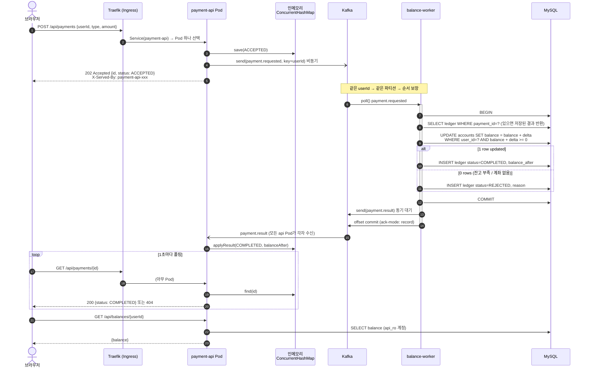

| 단계 | 사용하는 K8s 요소 |
|---|---|
| 1~2 | Ingress, Traefik, Service(ClusterIP), EndpointSlice |
| 4 | Kafka bootstrap 주소 = Service DNS `kafka.data-dev.svc.cluster.local` |
| 7~13 | NetworkPolicy(app 네임스페이스 → mysql 허용), Secret(DB 비밀번호) |
| 17 | Downward API(POD_NAME → consumer group id) |

---

## 2. 요청 라우팅 내부 동작

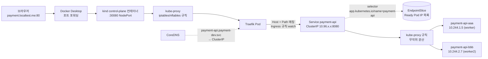

- **Service는 프로세스가 아닙니다.** 가상 IP와 kube-proxy가 만든 커널 규칙일 뿐이고, 실제 트래픽은 Pod IP로 바로 갑니다.
- **readinessProbe에 실패한 Pod는 EndpointSlice에서 빠집니다** → 트래픽을 받지 않습니다 (재시작은 하지 않음).
- Traefik은 Service의 EndpointSlice를 직접 읽어 Pod로 바로 보내기도 합니다 (구현마다 다름).
- 확인: `kubectl get endpointslices -n payment-dev -l kubernetes.io/service-name=payment-api -o wide`

---

## 3. Kafka 파티션과 Consumer Group

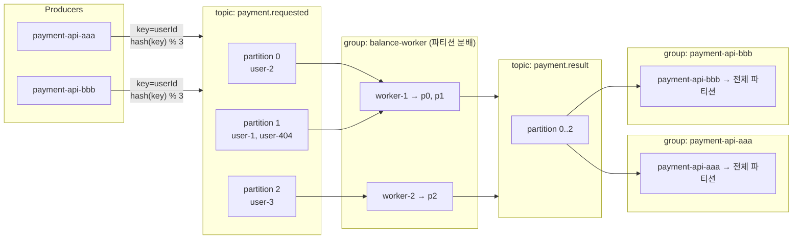

| 규칙 | 결과 |
|---|---|
| 하나의 파티션은 group 안에서 **한 consumer만** 읽는다 | worker replica를 4개 이상으로 늘려도 3개만 일한다 (파티션 수가 병렬도의 상한) |
| 같은 key는 항상 같은 파티션 | 한 사용자의 결제는 **순서대로** 처리된다 → 잔고 계산 race 없음 |
| group이 다르면 각자 전체를 읽는다 | api Pod마다 다른 group을 쓰면 **브로드캐스트**처럼 동작 |
| replica 수가 바뀌면 rebalance | worker를 스케일하면 잠깐 소비가 멈췄다가 파티션이 재분배된다 |

```bash
# 파티션 할당과 lag 확인
kubectl exec -n data-dev kafka-0 -- /opt/kafka/bin/kafka-consumer-groups.sh \
  --bootstrap-server localhost:9092 --describe --group balance-worker
```

---

## 4. 멀티 replica와 인메모리 상태 문제

payment-api는 결제 상태를 **Pod 메모리**에 보관합니다. replica가 2개 이상이면 다음과 같은 일이 생깁니다.

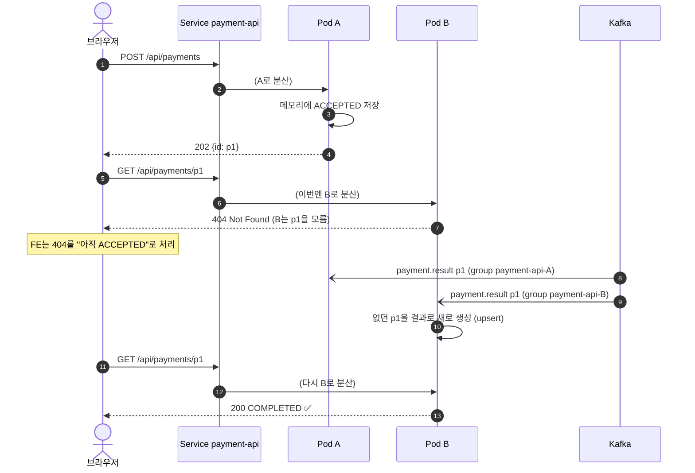

**배울 점**
- K8s Deployment의 Pod는 언제든 죽고, 바뀌고, 늘어납니다 → **애플리케이션은 Stateless여야 합니다.**
- 이 프로젝트는 "모든 Pod가 결과를 구독"하는 방식으로 최종 일관성(eventual consistency)을 맞췄지만, Pod가 재시작되면 그 Pod의 기록은 사라집니다.
- 실무 해법: **Redis 같은 외부 저장소**, 또는 sticky session(권장하지 않음), 또는 DB 조회.
- 직접 보기: FE 화면의 "응답 Pod" 열에 `(404)`가 찍히는 것을 확인하세요.

---

## 5. 장애 시나리오

### 5-1. worker가 처리 도중 죽음 → 재전송 → 멱등성으로 중복 방지

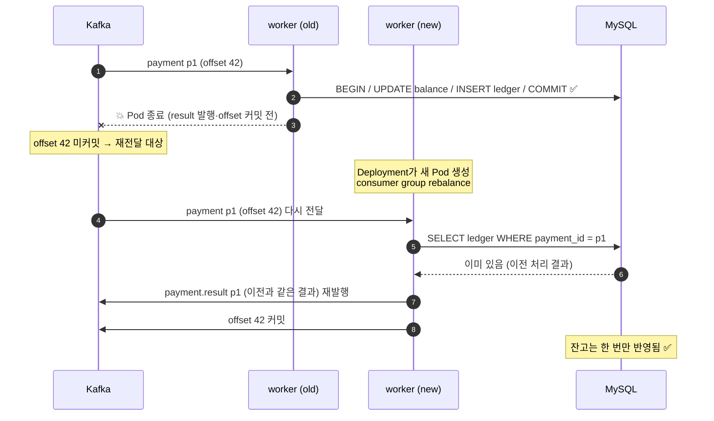

Kafka의 기본 보장은 **at-least-once**(최소 한 번)입니다. 그래서 consumer는 **멱등(idempotent)**해야 합니다. 이 프로젝트는 `payment_ledger.payment_id` **UNIQUE 제약**으로 멱등성을 구현합니다 (PK는 `AUTO_INCREMENT`로 생성하는 `id`). 먼저 조회해서 있으면 저장된 결과를 돌려주고, 두 consumer가 동시에 같은 결제를 처리하는 경합은 UNIQUE 위반 → 트랜잭션 롤백(잔고 반영 포함) → 재시도로 막습니다.

> ⚠️ dev는 `balanceWorker.ddlAuto: create`라 worker Pod가 **새로 뜰 때마다 테이블이 DROP/재생성**됩니다. 이 시나리오(새 Pod가 재전달 메시지 처리)를 관찰하려면 `--set balanceWorker.ddlAuto=update`로 배포하세요.

### 5-2. 잘못된 메시지 → 재시도 → DLT

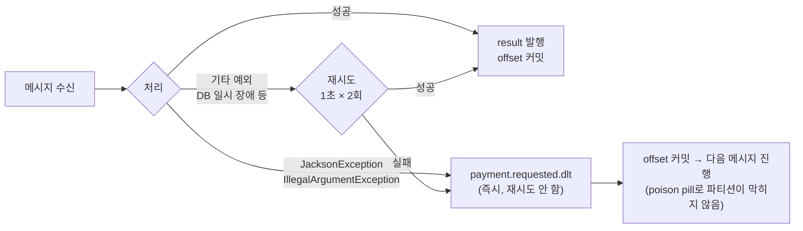

### 5-3. 장애 유형별 K8s 동작

| 장애 | K8s 반응 | 애플리케이션 영향 |
|---|---|---|
| payment-api 컨테이너 hang | livenessProbe 실패 → **컨테이너 재시작** | 그 Pod의 인메모리 상태 유실 |
| payment-api가 DB/Kafka 연결 불가 | readiness는 유지(기본 설정) | 요청은 받지만 전송 실패 시 FAILED |
| Pod OOMKilled | 컨테이너 재시작, `kubectl describe`에 `OOMKilled` | `-XX:MaxRAMPercentage=75`로 힙을 limit 안에 맞춤 |
| worker Pod 삭제 | Deployment가 새 Pod 생성, 처리 중이던 메시지는 재전달 | 멱등성으로 안전 |
| kafka-0 Pod 삭제 | StatefulSet이 **같은 이름·같은 PVC**로 재생성 | 데이터 보존, 잠시 produce 실패 → FAILED |
| mysql-0 Pod 삭제 | 같은 PVC로 재생성 | worker는 재시도 후 처리, 실패 시 DLT |
| worker2 노드 장애 | kafka/mysql은 required affinity라 **다른 노드로 못 감** → Pending | 실습 [06-labs.md](06-labs.md) 참고 |

---

## 6. Pod 기동과 종료 라이프사이클

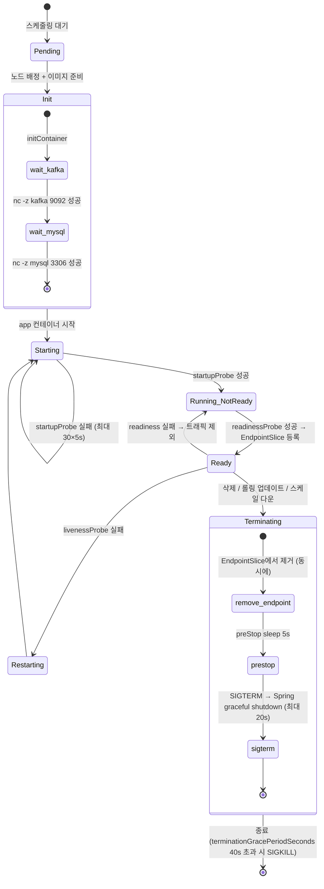

**preStop sleep이 필요한 이유**: Pod 삭제 시 "EndpointSlice에서 제거"와 "SIGTERM 전송"이 **동시에** 시작됩니다. kube-proxy와 Traefik이 변경을 반영하기 전에 앱이 먼저 내려가면 일부 요청이 실패합니다. 몇 초 기다리면 새 요청이 더 이상 들어오지 않습니다.

---

## 7. 롤링 업데이트

`maxSurge: 1, maxUnavailable: 0` 설정이므로 **새 Pod가 Ready가 된 뒤에** 기존 Pod를 하나씩 내립니다.

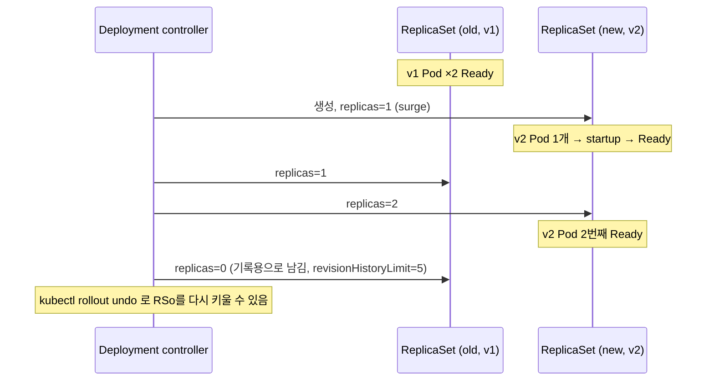

```bash
kubectl rollout status deploy/payment-api -n payment-dev
kubectl rollout history deploy/payment-api -n payment-dev
kubectl rollout undo deploy/payment-api -n payment-dev   # (GitOps에서는 git revert 권장)
```

---

## 8. HPA 오토스케일링 루프

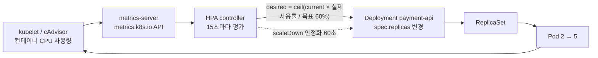

- 사용률은 **requests 대비** 비율입니다 (`requests.cpu: 100m`에서 80m 사용 → 80%). requests가 없으면 HPA가 동작하지 않습니다.
- HPA가 replicas를 관리하므로 Helm 템플릿은 HPA를 켜면 `spec.replicas`를 렌더링하지 않고, ArgoCD는 `ignoreDifferences`로 이 필드를 무시합니다.
- worker는 CPU보다 **consumer lag**를 기준으로 스케일하는 게 맞습니다 → KEDA(Kafka scaler)가 다음 학습 주제입니다.

---

## 9. 배포 워크플로우

### 9-1. 전체 부트스트랩 순서

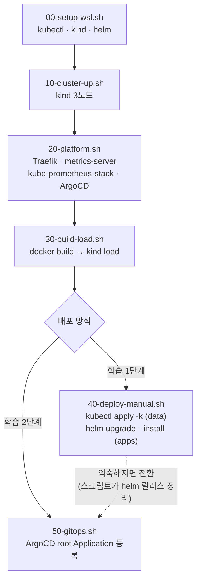

### 9-2. GitOps 변경 반영 흐름 (이미지 업데이트)

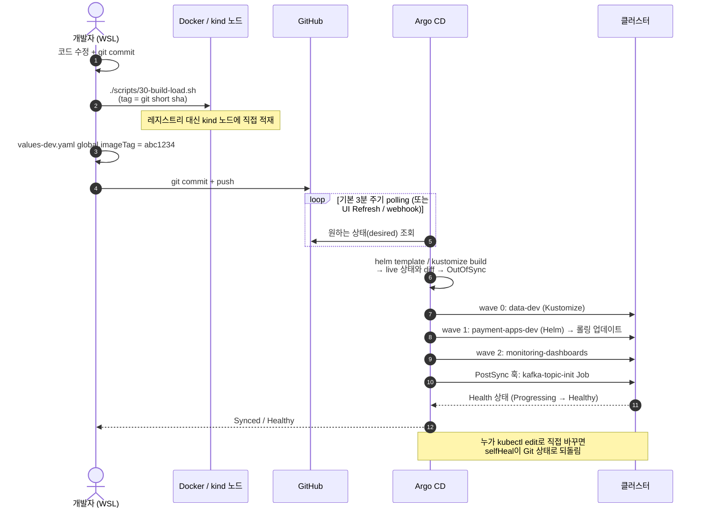

> 실무에서는 CI(GitHub Actions)가 이미지를 레지스트리에 push하고 values 태그를 자동으로 커밋합니다 (또는 Argo CD Image Updater 사용).

### 9-3. App of Apps 구조

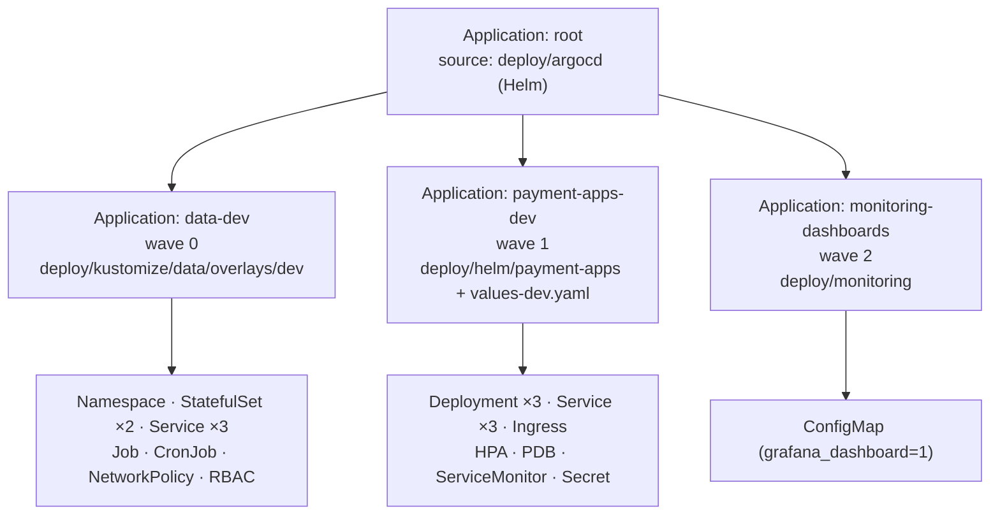

---

## 10. 모니터링 수집 흐름

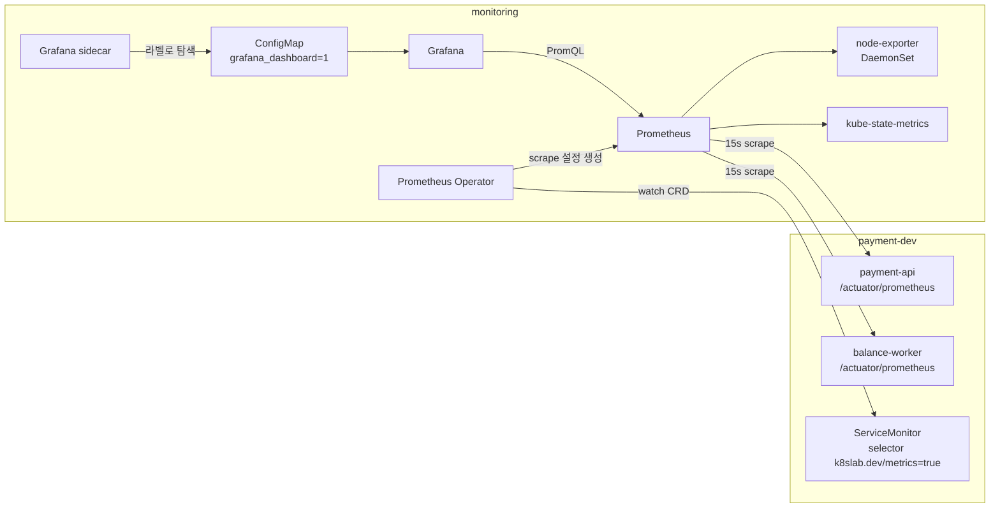

| 메트릭 | 출처 | 의미 |
|---|---|---|
| `payments_requested_total{type}` | payment-api (Micrometer counter) | 접수된 결제 수 |
| `payments_processed_total{status}` | balance-worker | 처리 결과별 수 |
| `payments_results_total{status}` | payment-api | api Pod가 받은 결과 이벤트 수 |
| `kafka_consumer_fetch_manager_records_lag_max` | worker의 Kafka 클라이언트 | consumer lag (밀린 메시지) |
| `http_server_requests_seconds_*` | Spring MVC | 요청 수와 지연 시간 |
| `container_cpu_usage_seconds_total` | kubelet/cAdvisor | Pod CPU |
