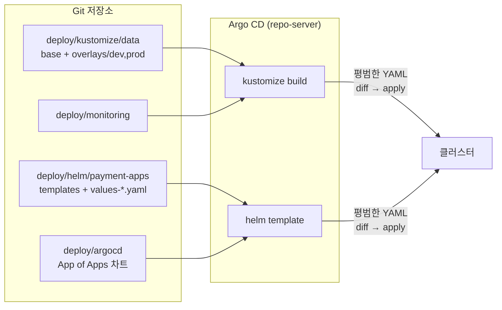

# 05. Helm · Kustomize · Argo CD

## 1. 도구별 역할

이 프로젝트는 같은 리소스를 두 도구로 중복 관리하지 않습니다. 실무에서 흔히 쓰는 방식대로 역할을 나눴습니다.

| 대상 | 도구 | 이유 |
|---|---|---|
| 서드파티 플랫폼 (Traefik, metrics-server, Prometheus, Argo CD) | **Helm 공식 차트** + values 파일 | 벤더가 차트를 제공하고 업그레이드를 관리한다. 우리는 값만 바꾼다 |
| 데이터 계층 (Kafka, MySQL, Job, CronJob, 정책) | **Kustomize** base/overlay | 순수 YAML이라 K8s 오브젝트 구조를 그대로 읽으며 배울 수 있다. 환경 차이는 patch로 표현 |
| 우리 앱 3개 | **직접 만든 Helm 차트** | 세 앱이 같은 패턴(Deployment + Service + probe + 보안설정)을 반복 → 템플릿과 헬퍼로 묶는다 |
| 위 전부의 배포 | **Argo CD** (App of Apps) | Git = 원하는 상태(desired state). 클러스터를 Git과 계속 일치시킨다 |



> Argo CD는 Helm 차트를 `helm install`하지 않고 **`helm template`으로 렌더링한 뒤 apply**합니다. 그래서 `helm list`에는 나타나지 않습니다.

---

## 2. Kustomize

### 구조
```
deploy/kustomize/data/
├─ base/                    # 환경 공통 (네임스페이스·Secret 없음)
│  ├─ kustomization.yaml    # resources + configMapGenerator
│  └─ mysql/ kafka/ jobs/ policies/
└─ overlays/
   ├─ dev/   namespace: data-dev, dev 비밀번호(secretGenerator literals)
   └─ prod/  namespace: data-prod, 리소스·스토리지 patch, CronJob 스케줄 JSON patch, secrets.env
```

### 자주 쓰는 명령
```bash
kubectl kustomize deploy/kustomize/data/overlays/dev            # 렌더링 결과만 보기
kubectl apply -k deploy/kustomize/data/overlays/dev             # 적용
kubectl diff  -k deploy/kustomize/data/overlays/dev             # 클러스터와 차이

# dev vs prod 비교 (prod는 secrets.env 필요)
cp deploy/kustomize/data/overlays/prod/secrets.env.example deploy/kustomize/data/overlays/prod/secrets.env
diff <(kubectl kustomize deploy/kustomize/data/overlays/dev) <(kubectl kustomize deploy/kustomize/data/overlays/prod)
```

### 핵심 기능 정리
| 기능 | 예시 위치 | 효과 |
|---|---|---|
| `namespace:` | overlays/*/kustomization.yaml | 모든 리소스의 namespace 일괄 지정 |
| `configMapGenerator` / `secretGenerator` | base, overlays | 파일·리터럴로 생성 + **해시 접미사**(내용이 바뀌면 이름이 바뀌고 참조도 자동 갱신) |
| Strategic Merge Patch | `prod/patch-*.yaml` | 일부 필드만 적은 YAML을 병합 (containers는 `name`으로 매칭) |
| JSON 6902 Patch | prod의 CronJob schedule | 경로(`/spec/schedule`)를 지정해 정확히 교체 |
| `images:` | prod | 이미지 태그 일괄 변경 |
| `labels:` | base, overlays | 공통 라벨 (`includeSelectors: false` → selector는 건드리지 않음) |

---

## 3. Helm

### 차트 구조
```
deploy/helm/payment-apps/
├─ Chart.yaml            # 차트 메타데이터 (version = 차트, appVersion = 앱)
├─ values.yaml           # 기본값
├─ values-dev.yaml       # dev 덮어쓰기
├─ values-prod.yaml      # prod 덮어쓰기
└─ templates/
   ├─ _helpers.tpl       # 라벨, 이미지, probe, initContainer, securityContext 공통 함수
   ├─ frontend.yaml / payment-api.yaml / balance-worker.yaml
   ├─ ingress.yaml / secret.yaml / serviceaccounts.yaml / servicemonitor.yaml
   └─ NOTES.txt          # 설치 후 출력되는 안내문
```

### 자주 쓰는 명령
```bash
CHART=deploy/helm/payment-apps
helm lint $CHART -f $CHART/values-dev.yaml
helm template payment-apps $CHART -f $CHART/values-dev.yaml | less          # 렌더링만
helm template payment-apps $CHART -f $CHART/values-prod.yaml \
  --set secrets.apiReadonlyPassword=x --set secrets.workerPassword=y         # prod 렌더링

helm upgrade --install payment-apps $CHART -n payment-dev -f $CHART/values-dev.yaml --set global.imageTag=abc1234
helm list -n payment-dev
helm history payment-apps -n payment-dev
helm rollback payment-apps 1 -n payment-dev
helm get values payment-apps -n payment-dev
```

### values 우선순위
`values.yaml` < `-f values-dev.yaml` < `--set key=value` (뒤에 오는 것이 이긴다)

### 템플릿에서 볼 만한 패턴
| 패턴 | 위치 |
|---|---|
| `include` + `nindent`로 공통 블록 삽입 | 모든 템플릿 |
| `required`로 필수값 검증 (prod 비밀번호 누락 시 렌더링 실패) | `secret.yaml` |
| 조건부 리소스 (`if .Values.x.enabled`) | HPA, PDB, ServiceMonitor |
| HPA를 쓰면 `replicas`를 렌더링하지 않음 | `payment-api.yaml` |
| `checksum/config` 어노테이션으로 ConfigMap이 바뀌면 롤링 재시작 | `frontend.yaml` |
| `range`로 반복 생성 | `serviceaccounts.yaml` |

---

## 4. Argo CD

### 개념
| 용어 | 의미 |
|---|---|
| Application | "Git의 어느 경로를 → 어느 클러스터/네임스페이스에" 배포할지 정의한 CRD |
| Sync | Git(desired)과 클러스터(live)를 일치시키는 작업 |
| OutOfSync / Synced | Git과 live가 다름 / 같음 |
| Healthy / Progressing / Degraded | 리소스 상태 (Deployment Ready 여부 등) |
| automated.prune | Git에서 삭제한 리소스는 클러스터에서도 삭제 |
| automated.selfHeal | 클러스터를 직접 수정하면 Git 상태로 되돌림 |
| sync-wave | 낮은 숫자부터 순서대로 동기화 |
| hook (PreSync/Sync/PostSync) | 동기화 전후에 실행하는 리소스 (주로 Job) |

### 이 프로젝트의 구성
- `deploy/argocd/root-app.yaml`: 최초 1회 `kubectl apply` (`sed`로 repo URL 등을 치환한 뒤 적용, 아래 "시작하기" 참고)
- `deploy/argocd/templates/*.yaml`: root가 만드는 하위 Application 3개 (wave 0, 1, 2)
- `payment-apps-dev`: `managedNamespaceMetadata`로 네임스페이스에 `k8slab.dev/role=app` 라벨 → NetworkPolicy 통과
- `ignoreDifferences: /spec/replicas` → HPA와 충돌 방지

> **App of Apps와 sync-wave**: Argo CD 1.8 이후로 Application 리소스 자체의 Health는 기본적으로 평가하지 않습니다. 그래서 wave 순서대로 "생성"은 되지만 앞 wave가 **Healthy가 될 때까지 기다리지는 않습니다.** 이 프로젝트는 앱의 initContainer가 Kafka/MySQL을 기다리기 때문에 문제가 없습니다. 엄격한 순서가 필요하면 `argocd-cm`에 Application health customization을 추가합니다.

### 시작하기
```bash
# 1) GitHub에 저장소 생성 후 push
git init && git add . && git commit -m "k8s lab" && git branch -M main
git remote add origin https://github.com/<you>/k8s-lab.git && git push -u origin main

# 2) 비공개 저장소라면 자격증명 등록 (Personal Access Token, repo read 권한)
kubectl -n argocd create secret generic repo-k8s-lab \
  --from-literal=type=git \
  --from-literal=url=https://github.com/<you>/k8s-lab.git \
  --from-literal=username=<you> \
  --from-literal=password=<PAT>
kubectl -n argocd label secret repo-k8s-lab argocd.argoproj.io/secret-type=repository

```

```bash
# 3) Lab 2에서 helm으로 직접 설치한 릴리스가 있으면 먼저 제거 (Argo CD와 같은 리소스를 두고 충돌한다)
helm list -n payment-dev
helm uninstall payment-apps -n payment-dev
```

```bash
# 4) root-app.yaml의 자리표시자(REPO_URL, TARGET_REVISION, MONITORING_ENABLED)에 넣을 값 준비
REPO_URL=$(git remote get-url origin); echo $REPO_URL        # HTTPS URL 권장 (git@... SSH는 키 등록 필요)
TARGET_REVISION=$(git rev-parse --abbrev-ref HEAD); echo $TARGET_REVISION   # 보통 main
kubectl get crd servicemonitors.monitoring.coreos.com          # 있으면 true, 없으면 false
MON=true

# 치환 결과를 먼저 눈으로 확인
sed -e "s#REPO_URL#${REPO_URL}#g" \
    -e "s#TARGET_REVISION#${TARGET_REVISION}#g" \
    -e "s#MONITORING_ENABLED#${MON}#g" \
    deploy/argocd/root-app.yaml

# 문제없으면 그대로 kubectl에 넘긴다 (-f - 는 stdin에서 읽기)
sed -e "s#REPO_URL#${REPO_URL}#g" \
    -e "s#TARGET_REVISION#${TARGET_REVISION}#g" \
    -e "s#MONITORING_ENABLED#${MON}#g" \
    deploy/argocd/root-app.yaml | kubectl apply -f -
```

```bash
# 5) 상태 확인 (잠시 후 root, data-dev, payment-apps-dev, monitoring-dashboards(MON=true일 때)가 Synced/Healthy)
kubectl get applications -n argocd -w
```
UI: http://argocd.localtest.me

### GitOps로 변경 반영하기
```bash
# 예: payment-api replicas/HPA 변경
vim deploy/helm/payment-apps/values-dev.yaml
git commit -am "scale payment-api" && git push
# → 3분 이내 자동 반영 (UI에서 Refresh를 누르면 즉시)

# selfHeal 체험
kubectl scale deploy/balance-worker -n payment-dev --replicas=0
kubectl get deploy balance-worker -n payment-dev -w     # 곧 Git 값으로 복구
```

---

## 5. Secret 관리 (실무)

이 프로젝트는 학습을 위해 dev 비밀번호를 Git에 평문으로 두었습니다. **실무에서는 절대 그렇게 하지 않습니다.**

| 방식 | 원리 |
|---|---|
| **Sealed Secrets** | 클러스터 공개키로 암호화한 `SealedSecret`을 Git에 커밋하고, 컨트롤러가 복호화해 Secret을 생성 |
| **External Secrets Operator** | AWS Secrets Manager, Vault, GCP SM 등의 값을 읽어 Secret으로 동기화 |
| **SOPS + KSOPS / helm-secrets** | 파일 단위로 암호화해 Git에 보관하고 배포 시 복호화 |
| Vault Agent Injector / CSI Secret Store | Pod에 직접 주입 (Secret 리소스를 만들지 않음) |
