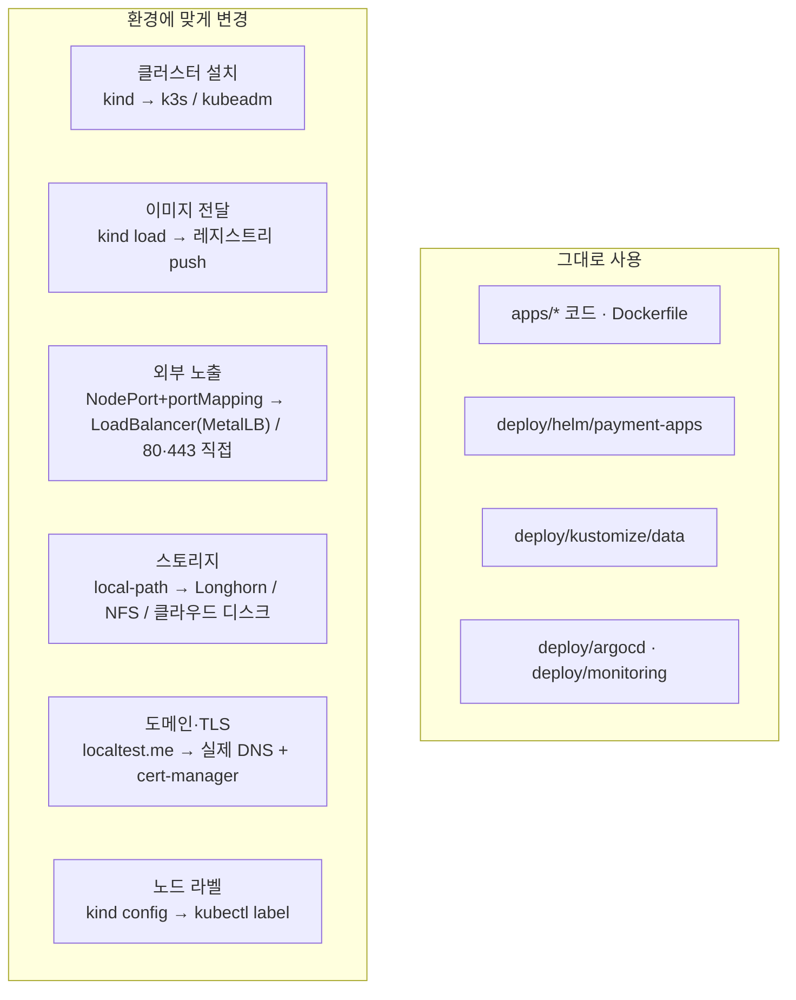

# 07. Ubuntu 서버로 옮기기 (k3s / kubeadm)

로컬 kind에서 익힌 것을 실제 Ubuntu 서버로 옮길 때 **바뀌는 부분만** 정리했습니다.
앱 코드, Helm 차트, Kustomize 매니페스트, Argo CD 구성은 **그대로** 씁니다.



## 변경 체크리스트

| 항목 | kind (로컬) | k3s 서버 | kubeadm 서버 |
|---|---|---|---|
| 설치 | `kind create cluster` | `curl -sfL https://get.k3s.io \| sh -` | containerd + kubeadm init/join + CNI |
| CNI / NetworkPolicy | kindnet (지원) | flannel + 내장 network policy controller | Calico / Cilium 설치 |
| Ingress Controller | Traefik(Helm 설치) | **Traefik 기본 내장** → `20-platform.sh`의 Traefik 단계 생략 | Traefik 또는 다른 컨트롤러 Helm 설치 |
| Service 노출 | NodePort 30080 + extraPortMappings | 내장 ServiceLB(Klipper)가 `LoadBalancer` 처리 | **MetalLB** 설치 후 `LoadBalancer` |
| StorageClass | `standard`(local-path) | `local-path` 기본 내장 | Longhorn / NFS provisioner / OpenEBS 설치 |
| metrics-server | Helm 설치 (`--kubelet-insecure-tls`) | **기본 내장** | Helm 설치 (정식 인증서면 insecure 옵션 불필요) |
| 이미지 | `kind load docker-image` | 레지스트리(GHCR, Harbor 등) push | 동일 |
| 노드 라벨 | kind-config `labels` | `kubectl label node <n> tier=data` | 동일 |
| kubeconfig | 자동 | `/etc/rancher/k3s/k3s.yaml` 복사 후 server 주소 수정 | `/etc/kubernetes/admin.conf` |

## 단계별로 옮기기 (k3s 예시)

```bash
# 1) 서버 3대: server 1 + agent 2
#    server
curl -sfL https://get.k3s.io | sh -s - --write-kubeconfig-mode 644
#    agents
curl -sfL https://get.k3s.io | K3S_URL=https://<server-ip>:6443 K3S_TOKEN=<node-token> sh -

# 2) 노드 라벨
kubectl label node agent-1 tier=app
kubectl label node agent-2 tier=data

# 3) 레지스트리에 이미지 push (예: GHCR)
docker build -t ghcr.io/<you>/k8s-lab/payment-api:0.1.0 apps/payment-api && docker push ghcr.io/<you>/k8s-lab/payment-api:0.1.0
#    비공개 레지스트리면 imagePullSecret 생성 후 ServiceAccount에 연결

# 4) values 수정
#    global.imageRegistry: "ghcr.io/<you>/"
#    global.imagePullPolicy: IfNotPresent
#    ingress.host: payment.<your-domain>
#    ingress.className: traefik   (k3s 기본)

# 5) 플랫폼: Traefik, metrics-server는 k3s에 이미 있으므로 생략
TRAEFIK=false METRICS_SERVER=false ./scripts/20-platform.sh

# 6) 배포 (수동 또는 GitOps): 동일
./scripts/40-deploy-manual.sh    # 또는 ./scripts/50-gitops.sh
```

## 운영 수준으로 가려면 (다음 학습 주제)

| 주제 | 도구 |
|---|---|
| TLS 인증서 자동 발급 | cert-manager + Let's Encrypt |
| Kafka 고가용성 | Strimzi Operator (브로커 3개, replication factor 3) |
| MySQL 고가용성/백업 | MySQL Operator(InnoDB Cluster), Percona Operator, 또는 관리형 DB |
| 비밀 관리 | External Secrets Operator + Vault / 클라우드 Secret Manager |
| 이벤트 기반 오토스케일 | KEDA (Kafka lag 기준 worker 스케일) |
| 로그 수집 | Loki + Promtail/Alloy (DaemonSet) 또는 EFK |
| 정책 강제 | Pod Security Admission(`restricted`), Kyverno / OPA Gatekeeper |
| 백업/복구 | Velero |
| CI | GitHub Actions: 테스트 → 이미지 빌드/push → values 태그 커밋 |
